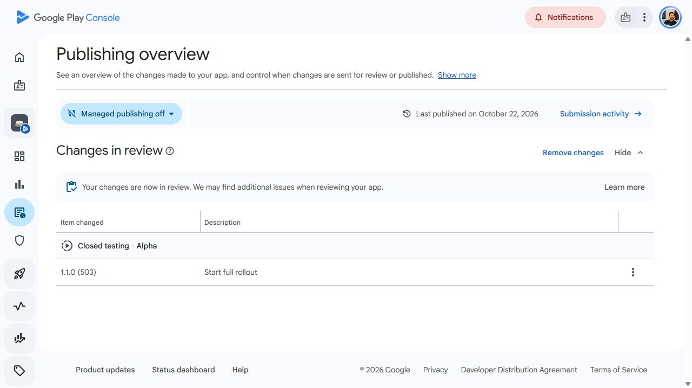

# Stones Android 1.1.0 (503)

**Submitted to Google Play review on 2026-10-24 (UTC).** The existing Alpha
track is configured for 100% rollout. Managed publishing remains off, so approval
publishes automatically. Store availability and physical-device acceptance are
separate from this submission.

## Source and version

The owner requested publication of prepared 1.0.0 (502), then requested a version
increase. Replacement source: `3995847bb5af77d59e4080d94f207eee6adf7975` on main.
Relative to prepared `72b9f1d609b3ae3e70f47748f98f7f64326cb6a3`, only
`pubspec.yaml` (1.0.0 to 1.1.0) and APP-07/APP-09 inventory documentation change.
Package remains `com.douglastkaiser.stones`. Android code explicitly set to 503.

Before upload, Play Console's complete bundle inventory contained exactly six
codes: 497, 481, 403, 385, 354 and 1. Thus 502 was unused and valid; 503 is the
replacement for the requested visible version bump, not a collision workaround.
Alpha served 1.0.0 (497); internal testing served 385; production was inactive
and open testing had not started.

## Qualification and artifacts

- [Replacement Android Release](https://github.com/douglastkaiser/stones/actions/runs/40049615757).
- [Replacement-source CI](https://github.com/douglastkaiser/stones/actions/runs/40049598302).
- [Replacement-source Firestore authorization](https://github.com/douglastkaiser/stones/actions/runs/40049598423).
- [Prepared 502 Android Release](https://github.com/douglastkaiser/stones/actions/runs/40048838676).
- [Original main CI](https://github.com/douglastkaiser/stones/actions/runs/40048489551)
  was superseded/cancelled when the version-bump source was pushed; it is not a
  complete successful qualification.
- [Original main Firestore authorization](https://github.com/douglastkaiser/stones/actions/runs/40048489531)
  passed.

The required [Firebase publication](FIREBASE_20261024.md) was already complete.
No Firebase deployment, index change or data migration is part of this release.

### Replacement-source qualification

First complete CI attempt passed all eleven jobs: 1,785 Flutter tests, strict
analysis, 45 release-tool checks, production/emulator web builds, Android debug
compilation, browser player journeys and independent Chromium/Firefox/WebKit
account and production-recovery jobs. The second complete attempt failed only
the WebKit emulator credentials suite:
`denied_storage_identity` timed out with persistent IndexedDB/localStorage
intentionally denied. Popup and browser-restart suites passed, as did production
WebKit recovery. This does not establish the timeout's cause or physical-device
behavior. No auth source or acceptance condition was changed to bypass it.
Failure artifact: `12544110009`, SHA-256
`b76f96f7327811ac2894f19f9715fa3d731980a019a5dad80e51ef3c6d996fda`.

Two fresh full CI qualifications were started in parallel on temporary refs
pointing to the exact same `3995847` commit:
[qualification A](https://github.com/douglastkaiser/stones/actions/runs/40051876001)
and [qualification B](https://github.com/douglastkaiser/stones/actions/runs/40051878724).
Both **complete eleven-job runs passed** on the exact same release source,
including all 1,785 Flutter tests and every independent three-engine account and
production-recovery suite. They finished successfully before store submission.
The refs change no application/source bytes; Android Release remains a main
build. The source required no gate waiver or code change. Temporary qualification
refs are removed after capturing their source-bound run evidence.

A failed-jobs-only main retry (attempt 3) repeated the same WebKit timeout; it was
not counted as a complete qualification. Artifact `12543498666` preserves that
failure. The original failures remain evidence of an intermittent web-emulator
test outcome; no root-cause repair or physical iOS success is claimed. The two
fresh complete runs, rather than a failed-job retry, supply the final full CI
evidence. See [the publication audit](../qa/android-503-publication.json).
Firestore authorization passed all 146 tests; committed backend
hashes match the already-published October 24 rules and index configuration.

### Prepared 502 verification (superseded, not uploaded)

Android Release completed successfully on the exact expected `72b9f1d` source:
signing/Firebase preflight, strict analysis, 1,785 Flutter tests, universal and
split APKs, AAB, all four APK signature verifications and artifact uploads.
`release.json` confirms package `com.douglastkaiser.stones`, version 1.0.0,
code 502, Flutter 3.47.7 and Play Games disabled. All APK certificate fingerprints
match the existing Console upload key.

- `stones-android-apks-502-72b9f1d`: artifact `12543520144`, digest `sha256:4fb9b15369ddea0a986a44a25e1460c6e42bd7f504c00b2da806461c90398704`.
- `stones-play-bundle-502-72b9f1d`: artifact `12543107686`, digest `sha256:4b71d4736b07319c1efddd5a5aadb8c253bd4e6f142ffb56c9d45d7d32a617dc`.
- `stones-android-report-502-72b9f1d`: artifact `12542948628`, digest `sha256:b4e35b7b4d27fd743f58cafa75fb48e8c789c59460bbc459c98c04881c63b5fd`.

The downloaded bundle/report ZIP digests match GitHub. ZIP integrity, the signed
manifest digest and all 669 signed entry digests passed. The detached PKCS#7
signature over UPLOAD.SF verified using .NET SignedCms and its public certificate
SHA-256 matches the existing Console upload key. Extracted 502 AAB SHA-256:
`5f4a95492d9db6b3ba2074bd7eda354f6c07b81c5560169069bc3248f70fc787`.
This AAB was retained for evidence and was not uploaded to Play because the
owner requested the visible version increase.

### Uploaded 503 artifact verification

Android Release succeeded on main source `3995847`: signing/Firebase preflight,
strict analysis, 1,785 Flutter tests, universal/split APK and AAB compilation,
all four APK signature verifications, artifact uploads and signing-key cleanup.
`release.json` confirms 1.1.0 (503), package `com.douglastkaiser.stones`, exact
source `3995847bb5af77d59e4080d94f207eee6adf7975`, Flutter 3.47.7 and Play Games
disabled. All APK certificate SHA-256 values match the existing upload key.

- [`stones-play-bundle-503-3995847`](https://github.com/douglastkaiser/stones/actions/runs/40049615757/artifacts/12543951561): `sha256:eee2706b3e1ebb238bafdc6a6846af4fa5352caaebe9c3d0d8c41d49e9ad3f7c`.
- [`stones-android-apks-503-3995847`](https://github.com/douglastkaiser/stones/actions/runs/40049615757/artifacts/12543807038): `sha256:a61c498cdd28495df9e07d1050603a78b1fefef0ade5c8d26cab86337024c56b`.
- [`stones-android-report-503-3995847`](https://github.com/douglastkaiser/stones/actions/runs/40049615757/artifacts/12543298848): `sha256:8c05bb69f7e5703dc854f615928bf05360f67141055b3e36b462086172df0493`.

The downloaded bundle/report ZIP SHA-256 values match GitHub. Extracted AAB
SHA-256: `25c18f7d057cb2e8155e8aaf1f2d589cd4f0d30588640ef08e2b292528d67ca3`.
ZIP integrity, signed manifest and all 669 signed entry digests passed; the
PKCS#7 signature verified and its certificate matches the existing Console
upload identity. The extracted `app-release.aab` was uploaded to Alpha, without
repacking or rebuilding locally. Store processing/review status is recorded below.

## Signing and retained settings

Existing upload certificate SHA-1:
`FA:63:FB:8F:BB:9B:27:F6:90:54:1B:E7:BC:11:62:AC:90:3A:30:CB`.
Upload certificate SHA-256:
`FD:BA:27:BE:F8:1C:84:11:96:FA:B7:75:64:24:2F:68:4E:38:55:06:3D:17:91:65:CB:FD:16:BA:E5:94:D5:65`.
Play app-signing certificate SHA-256:
`C1:B2:D1:79:4D:94:7B:D3:F1:73:94:01:72:11:56:30:85:75:EF:21:EE:33:C2:E9:45:AF:0E:67:F1:88:08:A2`.
These public fingerprints were read from Console before upload. No key reset,
rotation, credential change or signing-setting change was requested or made.

Track: existing Closed testing - Alpha, ID `4698915010481104074`.
Retained selected email list Stones Testing (three users), United States only
(Console says includes seven locations), existing feedback destination and
opt-in links. Tester selection and country targeting were re-read after saving
the release and remained unchanged. Managed publishing is off, preserving
automatic publishing after approval. Internal testing remains 385; open testing
and production were unchanged.

The prior local 497 AAB remains preserved outside source control at
`stones-release-497/app-release.aab`, SHA-256
`e0c00135dea7db92d8f15e4593603355b8eda874a9e12fea0c95c52e922a5981`.
Older code cannot be re-uploaded as a downgrade; any corrective release needs a
new higher code and the same signing identity.

## Play acceptance and rollout preview

Play processed and accepted the exact AAB as 503 (1.1.0), minimum API 24,
target SDK 36, four screen layouts, three ABIs and two required features.
Release preview reported **Ready to release** without a blocking error. Device
comparison against 497 showed zero losses and zero newly supported devices in
every form factor: 12,412 phones, 6,816 tablets, seven TVs, 27 cars, 77 Chromebooks
and one Android XR device; no wearable devices. Catalog exclusions are not
included in that comparison. These are store compatibility counts, not device
trials. Play estimated 16.1 MB for new installs (39.3 KB above 497), 1.69 MB for
updates and nine seconds download time; these are store estimates.

The release was saved with **100.0% rollout** to the existing eligible Alpha
testers and the requested en-US notes. Saving to Publishing overview is not
submission; the final outcome is recorded separately below.

## Submission outcome

Verified at **2026-10-24 02:13 UTC**: Publishing overview explicitly says
**Changes in review** and **Your changes are now in review**. Google quick
checks completed successfully. The submitted queue contained exactly one change:
**Closed testing - Alpha — 1.1.0 (503) — Start full rollout**.
This is submitted, not a draft. Version 503 is not yet available to testers.
Managed publishing remains off; approval publishes automatically. Alpha 497
was the serving release before submission; internal testing remains 385.
No physical-device trial was performed.

## Release notes

Human-only leaderboard ranks now match your account and profile. Tap Your
standing to open your profile. Improved multiplayer AI, piece depth, stack
inspection and movement controls. Includes Google sign-in recovery and
saved-game reliability improvements.

## Acceptance limits

CI tests/builds/signature checks and Play acceptance are separate evidence from
physical-device use. Play-signed install/update from 497, real Google credential
exchange and recovery, saved-game continuity, Square/Hex stack controls, online
multi-device play, audio/sharing/App Links and TalkBack remain untested on a
physical device for this exact artifact. Full AI strength/native timing
qualification remains open as recorded in [AI upgrades](../AI_UPGRADES.md).
Existing web and Firebase publication evidence is unchanged by this Android
release. Feature inventory IDs updated: APP-07 and APP-09; adjacent journeys
include APP-06 install/startup, account recovery, saved-game and play controls.
