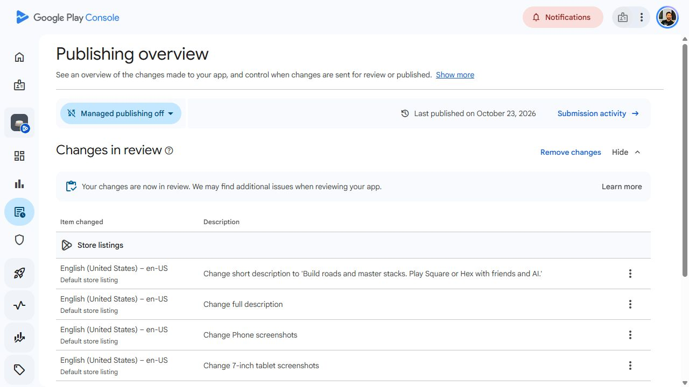

# Stones 1.1.0 Play listing refresh

The owner requested updated Google Play images and descriptions after Android
1.1.0 (503) was submitted to Alpha. Listing submission and binary availability
are separate outcomes; [Android 503](ANDROID_503.md) retains the binary evidence.

## Content and assets

The live listing had a 25-character short description, a 29-character full
description, three January phone screenshots and one old screenshot in each
tablet category. The new English copy describes actual Square/Hex variants,
two-to-four-player tables, mixed local/online/AI seats, learning, stack inspection,
local saves, styles and human rankings. It distinguishes offline local play
from online services and states that achievements, unlocks and preferences do
not synchronize across devices. Unsupported purchase promises in the older
checked-in copy were removed. The app name and icon are retained.

The refresh contains six 1080x1920 phone images, two 1920x1080 screenshots in
each tablet category, and a new 1024x500 RGB PNG feature graphic. Captions and
framing are code-native; the application UI inside each image is unaltered.
The editable feature illustration follows the actual Square capture position
and current wood/ivory/charcoal palette. No generated imitation UI is used.

[Asset manifest](../../store_listing/assets_1_1_0.json) records file hashes,
dimensions, UTF-8 copy lengths, source, build and viewports. The production web
artifact is from the exact Android application source `3995847`, with its ZIP
digest and every manifest file verified. Auth and backend hashes were compared
with canonical Git bytes rather than the Windows checkout's CRLF encoding.
These browser captures are not physical Android install or usability evidence.
No real Google credentials or shared online rooms were used for the captures.

## Tester enrollment

Existing opt-in link:
https://play.google.com/apps/testing/com.douglastkaiser.stones

It enrolls an eligible account in the test; it does not add arbitrary users to
the selected email list. First add a consenting tester's Google Play account
email to the existing **Stones Testing** list, then have them open that link
using that same Google account. The list currently contains three users and
Alpha targets the United States. No self-service list-addition link or Google
Group was configured, and tester/country settings were not changed.

## Verification and outcome

All eleven replacement images passed dimension/file-size checks and visual
review. Each caption fits, every UI image loaded, and the complete stack
inspector is visible. Console accepted and previewed six phone screenshots,
two 7-inch screenshots, two 10-inch screenshots and the feature graphic.
The short description is 70/80 characters and full description 1903/4000
(Console normalizes Windows CRLF line endings). App name/icon were retained;
Desktop/XR assets and video remain empty.

The six captioned phone compositions and feature illustration were declared
created/edited with AI through the asset-specific declaration flow. The actual
application captures remain unaltered. Raw tablet captures and the unchanged
icon were not labeled. The [Play declaration guidance](https://support.google.com/googleplay/android-developer/answer/17262077?hl=en)
was read before completing the declaration.

The listing was reviewed, saved, and **Send changes for review** was confirmed
for exactly six changes: short description, full description, phone screenshots,
7-inch screenshots, 10-inch screenshots and feature graphic. Publishing overview
shows **Changes in review** and **Your changes are now in review** after quick
checks completed, verified on 2026-10-24 UTC. This is submitted, not a draft, and is not yet a live-listing acceptance
claim. Managed publishing remains **off**, so approval publishes automatically.

During this follow-up, Alpha 503 separately became **Available to selected testers**
at **100% rollout**, verified at 17:04 UTC. Console shows zero users/install-base
adoption; no physical installation is established. The Test and release summary
also surfaces SafetyNet SDK, edge-to-edge and 16 KB alignment advisory cards for
503. These did not block this accepted release and were not repaired or verified
on a device in this store-copy task.

Feature ID updated: APP-10; APP-07/09 retain the binary version/distribution
evidence. Physical-device acceptance remains separate.
